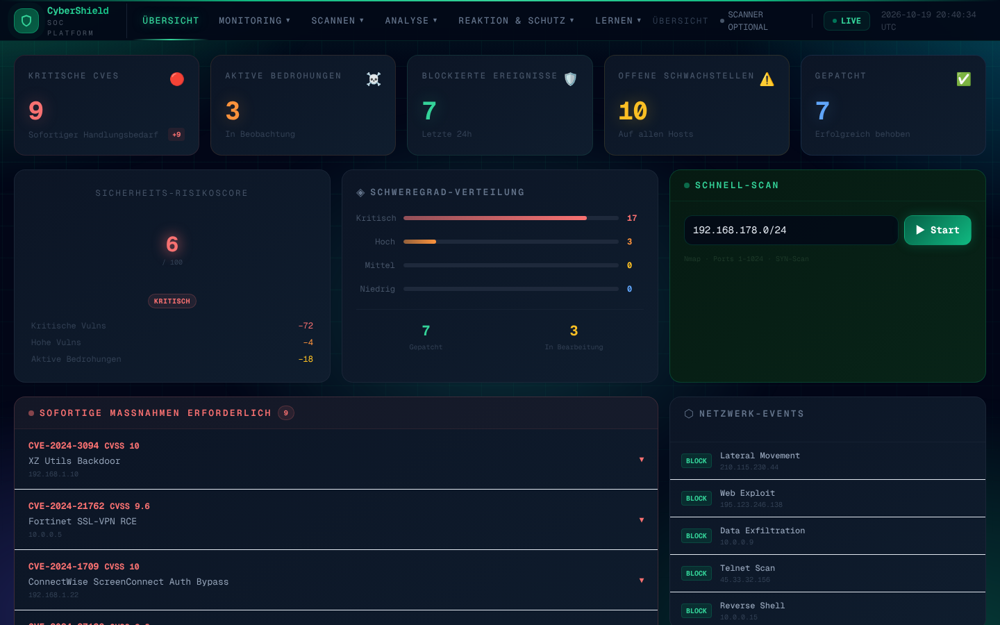
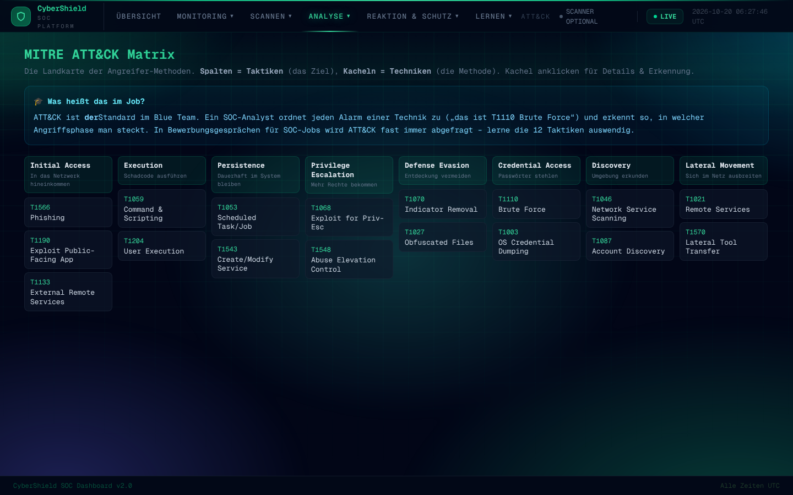
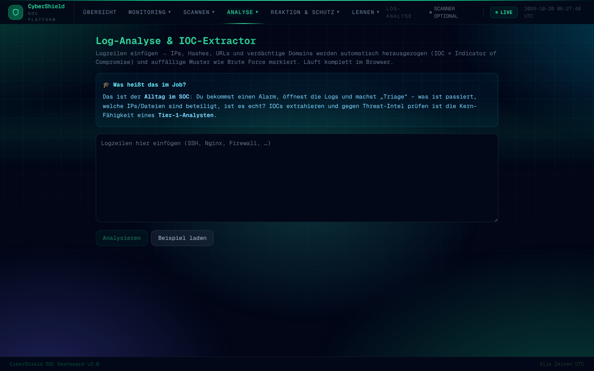
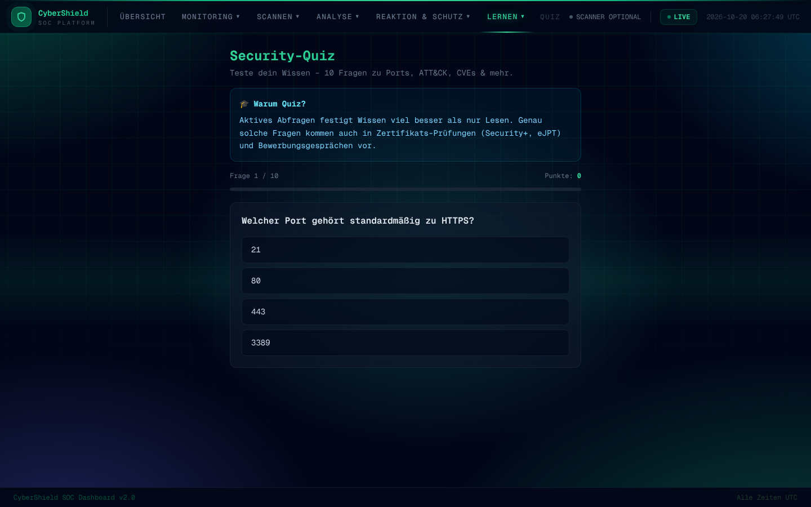
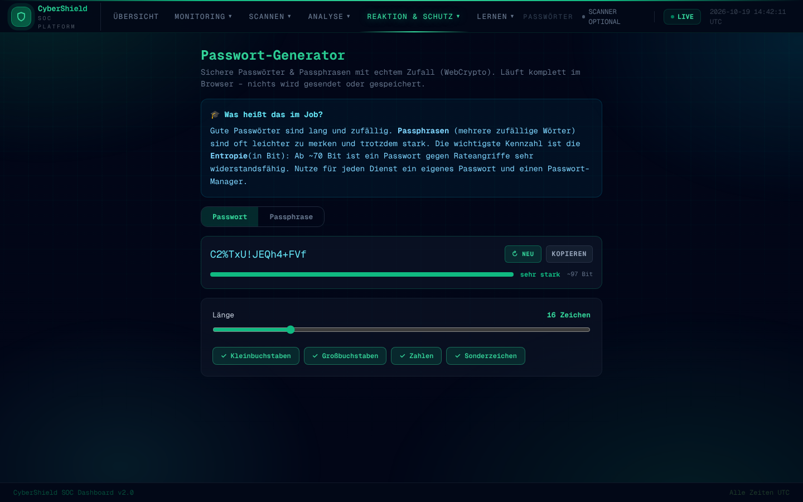
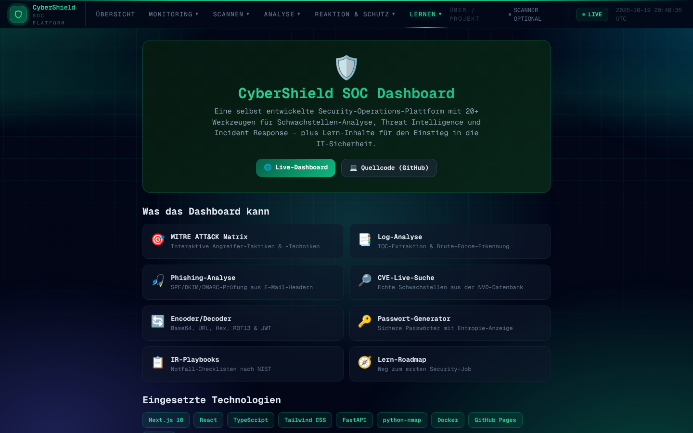
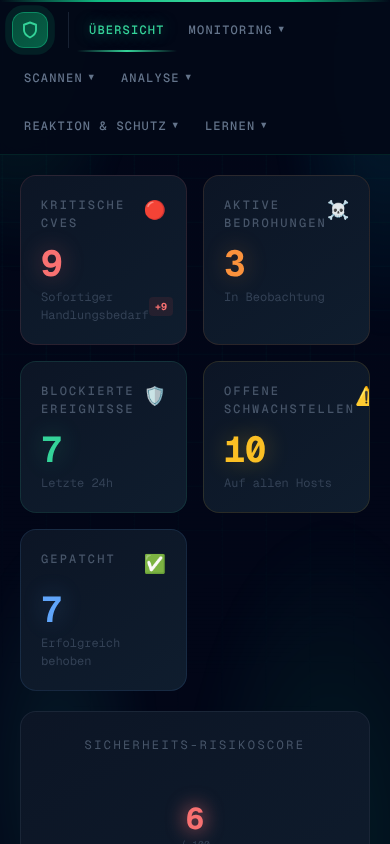

<div align="center">

# 🛡️ CyberShield — SOC Dashboard

**Eine selbst entwickelte Security-Operations-Plattform mit 20+ Werkzeugen für Schwachstellen-Analyse, Threat Intelligence, Incident Response — plus Lern-Inhalte für den Einstieg in die IT-Sicherheit.**

[](https://enesdoudouzi-sys.github.io/security-dashboard/)
&nbsp;


### 👉 [**Live ansehen**](https://enesdoudouzi-sys.github.io/security-dashboard/)

</div>



---

## ✨ Was kann das Dashboard?

Ein modernes SOC-Dashboard im dunklen „Leitstand"-Look — läuft auf **Desktop & Handy**, komplett im Browser (kein Login, keine Datenbank, nichts wird gesendet). Jedes Werkzeug hat einen **„Was heißt das im Job?"**-Lernkasten.

| Bereich | Werkzeuge |
|---|---|
| **🖥️ Monitoring** | Übersicht mit Risk-Score & KPIs · Schwachstellen · Bedrohungen · Netzwerk-Events · Scans |
| **🔍 Scannen** | Schwachstellen-Scan (Nmap-Backend) · CVE-Live-Suche (NVD) · Befehls-Cheatsheet |
| **🧪 Analyse** | MITRE ATT&CK Matrix · Log-Analyse & IOC-Extractor · Phishing-/E-Mail-Header-Analyse · Encoder/Decoder (Base64/Hex/JWT) · Netz- & Hash-Tools |
| **🚨 Reaktion & Schutz** | Incident-Response-Playbooks · PC-Schutz · System-Härtung · Passwort-Generator · Sicherheits-Status |
| **🎓 Lernen** | Lern-Roadmap zum ersten Security-Job · Security-Quiz · Logbuch · Projekt-Übersicht |

---

## 📸 Screenshots

<table>
  <tr>
    <td width="50%"><b>MITRE ATT&CK Matrix</b><br></td>
    <td width="50%"><b>Log-Analyse & IOC-Extractor</b><br></td>
  </tr>
  <tr>
    <td><b>Security-Quiz</b><br></td>
    <td><b>Passwort-Generator</b><br></td>
  </tr>
  <tr>
    <td><b>Projekt-Übersicht</b><br></td>
    <td valign="top"><b>Mobil-optimiert</b><br></td>
  </tr>
</table>

---

## 🧰 Technik

**Frontend:** Next.js 16 (Static Export) · React · TypeScript · Tailwind CSS — gehostet auf **GitHub Pages**
**Backend (optional):** FastAPI · python-nmap · SQLAlchemy/SQLite · Docker — deploybar auf **Render**

Das Frontend funktioniert **komplett ohne Backend**. Das Backend wird nur für echte Live-Nmap-Scans gebraucht.

### Sicherheit
- **Content-Security-Policy** (per Meta), `nosniff`, strenger Referrer
- Statische Architektur → minimale Angriffsfläche (kein Server/Login/DB im Frontend)
- Backend: Ziel-**Freigabeliste** (`ALLOWED_TARGETS`), **Ratenlimit** pro IP, optionaler **API-Schlüssel**

---

## 🚀 Lokal starten

```bash
# Frontend
npm install
npm run dev            # http://localhost:3000

# Backend (optional, für echte Scans)
cd backend
pip install -r requirements.txt
uvicorn main:app --reload   # http://localhost:8000
pytest -q                   # Tests
```

**Anleitungen:** [Live schalten](docs/DEPLOY.md) · [Legales Hacking lernen](docs/LERNEN.md) · [Übungslabor](docs/LABOR.md)

---

## ⚖️ Rechtlicher Hinweis

> Alle Scan-Werkzeuge sind ausschließlich für **legales Üben** gedacht — nur gegen
> **`scanme.nmap.org`** (offiziell freigegeben), Localhost oder **eigene Systeme**.
> Das Backend scannt per Freigabeliste nur erlaubte Ziele. Fremde Systeme ohne
> ausdrückliche schriftliche Erlaubnis zu scannen ist strafbar (§ 202a ff. StGB).

---

<div align="center">

Entwickelt von **Enes Doudouzi** · als Lern- und Portfolio-Projekt

</div>
