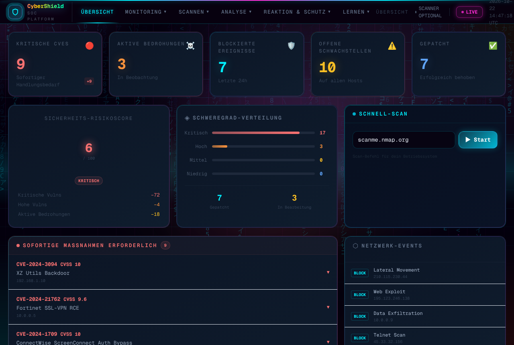
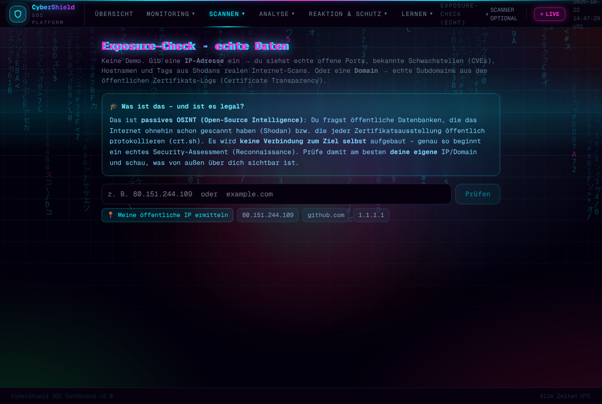
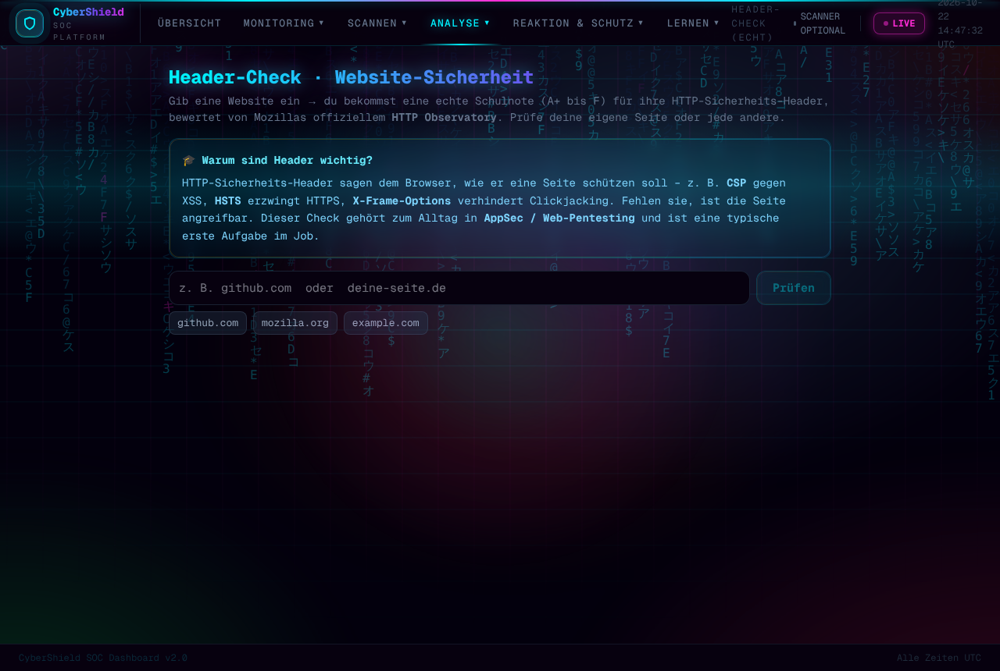
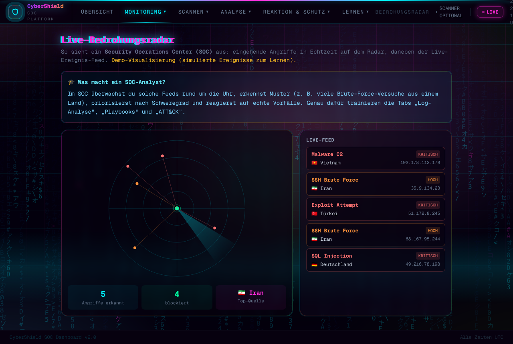
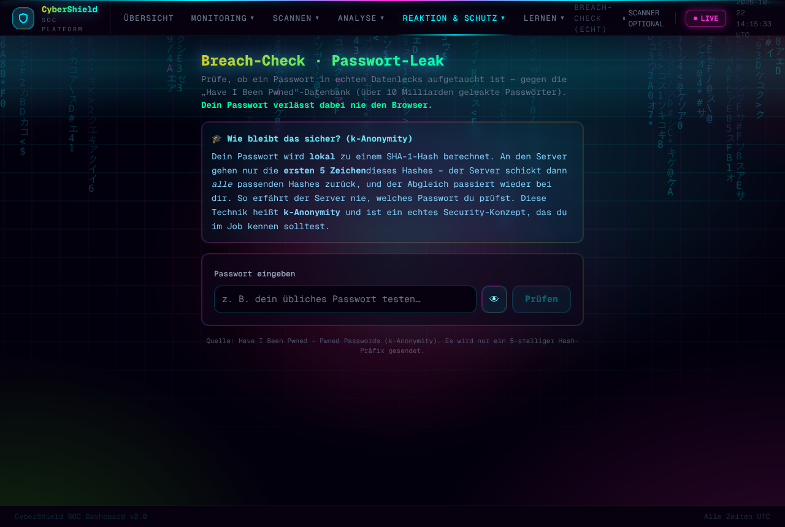
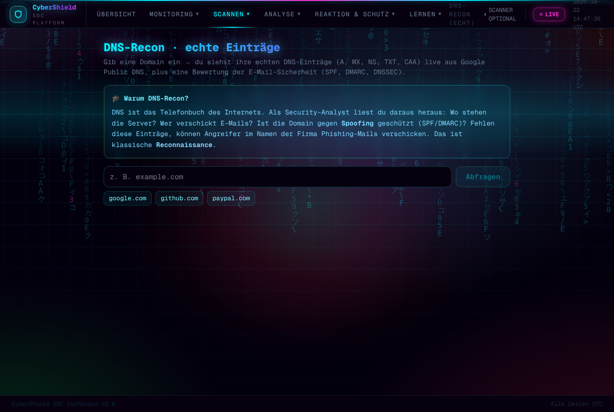
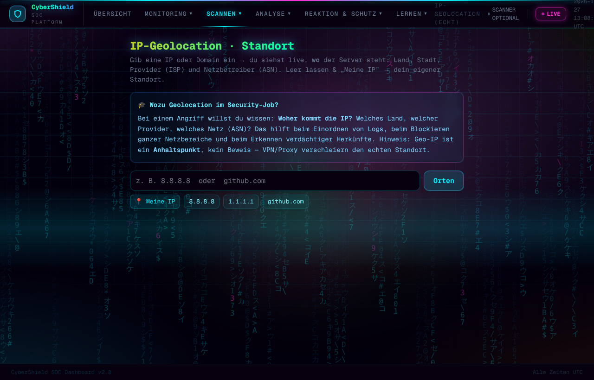
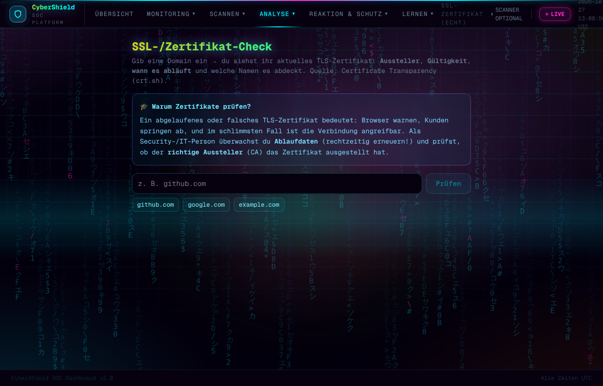

<div align="center">

# 🛡️ CyberShield — SOC Dashboard

**Eine selbst entwickelte Security-Operations-Plattform mit 30+ Werkzeugen — darunter 6 Tools mit *echten Live-Daten* (Shodan, DNS, IP-Geolocation, Mozilla Observatory, SSL-Zertifikate, Have I Been Pwned) — für Schwachstellen-Analyse, Threat Intelligence & Incident Response, plus Lern-Inhalte für den Einstieg in die IT-Sicherheit.**

[](https://enesdoudouzi-sys.github.io/security-dashboard/)
&nbsp;


### 👉 [**Live ansehen**](https://enesdoudouzi-sys.github.io/security-dashboard/)

</div>



---

## ⭐ Highlights: Tools mit *echten* Live-Daten (kein Demo)

Diese Werkzeuge fragen echte öffentliche Quellen live ab — passiv & legal, direkt im Browser:

| Tool | Was es macht | Echte Quelle |
|---|---|---|
| 🛰 **Exposure-Check** | echte offene Ports, bekannte CVEs, Hostnamen & Subdomains einer IP/Domain | Shodan InternetDB · crt.sh |
| 🌐 **DNS-Recon** | echte DNS-Einträge + E-Mail-Schutz-Bewertung (SPF/DMARC/DNSSEC) | Google Public DNS |
| 📍 **IP-Geolocation** | zeigt Standort, Provider (ISP) und Netzbetreiber (ASN) einer IP/Domain | ipwho.is |
| 🔐 **Header-Check** | echte Sicherheits-Note (A+…F) für die HTTP-Header einer Website | Mozilla HTTP Observatory |
| 📜 **SSL-/Zertifikat-Check** | TLS-Zertifikat prüfen: Aussteller, Gültigkeit, Ablauf-Countdown, Domains | crt.sh (Certificate Transparency) |
| 🔑 **Breach-Check** | prüft Passwörter gegen echte Datenlecks — per k-Anonymity (Passwort verlässt nie den Browser) | Have I Been Pwned |
| 💻 **Lokaler Scan** | wertet `netstat`/`Get-NetTCPConnection`-Ausgaben aus und bewertet offene Ports nach Risiko | eigenes Python-Backend |

---

## ✨ Alle Bereiche

Ein modernes SOC-Dashboard im **Cyberpunk-Neon-Look** (animierte Aurora, Glitch-Effekte) — läuft auf **Desktop & Handy**, komplett im Browser (kein Login, keine Datenbank). Jedes Werkzeug hat einen **„Was heißt das im Job?"**-Lernkasten.

| Bereich | Werkzeuge |
|---|---|
| **🖥️ Monitoring** | Übersicht mit Risk-Score & KPIs · **Live-Bedrohungsradar** · Schwachstellen · Bedrohungen · Netzwerk-Events |
| **🔍 Scannen** | **Exposure-Check** · **DNS-Recon** · **IP-Geolocation** · **Lokaler Scan** · Schwachstellen-Scan (Nmap-Backend) · CVE-Live-Suche (NVD) |
| **🧪 Analyse** | **Header-Check** · **SSL-/Zertifikat-Check** · MITRE ATT&CK Matrix · Log-Analyse & IOC-Extractor · Phishing-/E-Mail-Header-Analyse · Encoder/Decoder (Base64/Hex/JWT) |
| **🚨 Reaktion & Schutz** | **Breach-Check** · Incident-Response-Playbooks · PC-Schutz · System-Härtung · Passwort-Generator |
| **🎓 Lernen** | Lern-Roadmap zum ersten Security-Job · Challenges · Security-Quiz · Fortschritts-Tracker · Logbuch |

---

## 📸 Screenshots

<table>
  <tr>
    <td width="50%"><b>🛰 Exposure-Check (Shodan + crt.sh)</b><br></td>
    <td width="50%"><b>🔐 Header-Check (Mozilla Observatory)</b><br></td>
  </tr>
  <tr>
    <td><b>📡 Live-Bedrohungsradar</b><br></td>
    <td><b>🔑 Breach-Check (Have I Been Pwned)</b><br></td>
  </tr>
  <tr>
    <td><b>🌐 DNS-Recon (SPF/DMARC/DNSSEC)</b><br></td>
    <td><b>📍 IP-Geolocation (Standort/ISP/ASN)</b><br></td>
  </tr>
  <tr>
    <td><b>📜 SSL-/Zertifikat-Check (crt.sh)</b><br></td>
    <td valign="top"><b>🖥️ Übersicht (SOC-Startseite)</b><br></td>
  </tr>
</table>

---

## 🧰 Technik

**Frontend:** Next.js 16 (Static Export) · React · TypeScript · Tailwind CSS — gehostet auf **GitHub Pages**
**Backend (optional):** FastAPI · python-nmap · SQLAlchemy/SQLite · Docker — deploybar auf **Render**

Das Frontend funktioniert **komplett ohne Backend**. Das Backend wird nur für echte Live-Nmap-Scans gebraucht.

### Sicherheit
- **Content-Security-Policy** (per Meta), `nosniff`, strenger Referrer
- Statische Architektur → minimale Angriffsfläche (kein Server/Login/DB im Frontend)
- Backend: Ziel-**Freigabeliste** (`ALLOWED_TARGETS`), **Ratenlimit** pro IP, optionaler **API-Schlüssel**

---

## 🚀 Lokal starten

```bash
# Frontend
npm install
npm run dev            # http://localhost:3000

# Backend (optional, für echte Scans)
cd backend
pip install -r requirements.txt
uvicorn main:app --reload   # http://localhost:8000
pytest -q                   # Tests
```

**Anleitungen:** [Live schalten](docs/DEPLOY.md) · [Legales Hacking lernen](docs/LERNEN.md) · [Übungslabor](docs/LABOR.md)

---

## ⚖️ Rechtlicher Hinweis

> Alle Scan-Werkzeuge sind ausschließlich für **legales Üben** gedacht — nur gegen
> **`scanme.nmap.org`** (offiziell freigegeben), Localhost oder **eigene Systeme**.
> Das Backend scannt per Freigabeliste nur erlaubte Ziele. Fremde Systeme ohne
> ausdrückliche schriftliche Erlaubnis zu scannen ist strafbar (§ 202a ff. StGB).

---

<div align="center">

Entwickelt von **Enes Doudouzi** · als Lern- und Portfolio-Projekt

</div>
